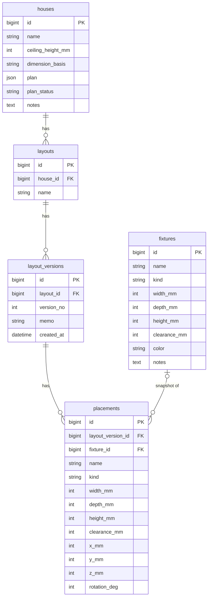

# HomeFit 설계서 — 집기 배치 시뮬레이터

- 문서 버전: 0.1 (2026-11-01)
- 상태: 초안, M1 착수 기준
- 스택: Ruby 3.4 / Rails 8.x / MySQL 8.0 / vite_rails + React 19 + TypeScript / React Three Fiber / Konva / Active Storage / Solid Queue

---

## 0. 목적과 범위

입주 전인 집의 도면 이미지로 3D 주택 오브젝트를 만들고, 치수를 가진 집기(가구·가전) 오브젝트를 그 안에 배치해 "들어가는지, 동선이 나오는지"를 확인한다. 배치는 저장할 때마다 버전으로 쌓이며 모든 버전을 보존한다.

### 단계 구분

| 단계 | 내용 | 이 문서 |
|---|---|---|
| Stage 1 | 도면 이미지를 배경으로 깔고 사용자가 벽을 따라 그림 + 축척·검증 입력. 집기는 치수 박스 + 옆면 4면 텍스처 + 이름 라벨. 배치·충돌·버전. | **전부 포함** |
| Stage 2 | 비전 LLM으로 도면에서 벽·치수 자동 추출 → 사용자 보정 | 데이터 모델에 자리만 비워둠 |
| Stage 3 | 집기 이미지 → 실제 3D 메시(외부 image-to-3D API) | 범위 밖 |

### 용어

- **주택(House)**: 도면 1장으로 만들어진 공간. 벽 집합 + 천장고.
- **집기(Fixture)**: 가구·가전·기타. 치수(W×D×H mm)를 가진다.
- **배치도(Layout)**: 주택 1개에 속하는 배치 작업 단위. 이름을 가진다.
- **버전(LayoutVersion)**: 배치도의 저장 스냅샷. 불변. 번호는 1부터 증가.
- **배치(Placement)**: 특정 버전 안에서 집기 1개의 위치·회전. 저장 시점의 집기 치수를 스냅샷으로 가진다.

---

## 1. 핵심 규칙 (요구사항 → 규칙)

| ID | 규칙 | 근거 요구사항 |
|---|---|---|
| R-01 | 모든 길이는 **정수 mm**, 회전은 **정수 도(0–359)**. DB·API·프론트 공통. | 3 |
| R-02 | 좌표계: 도면 이미지 좌상단이 원점, x는 오른쪽(+), y는 아래(+). 3D에서는 y_mm → z축으로 매핑하고 높이가 y축. | 1, 4 |
| R-03 | 주택은 **파라메트릭 JSON**(벽 선분 목록)으로 저장한다. 메시(OBJ/GLB)는 저장하지 않고 클라이언트에서 압출로 생성한다. | 2 |
| R-04 | 도면 이미지를 쓰는 주택은 **축척(px_per_mm)이 설정**되어야 저장 가능하다. 도면에 치수 표기가 없어 축척을 못 잡으면 저장 거부. | 1 |
| R-05 | 검증 측정이 있으면 오차 **3% 초과 시 저장 거부**(도면 왜곡 또는 축척 오류로 간주). | 1 |
| R-06 | 벽은 3개 이상이어야 주택을 저장할 수 있다. | 1 |
| R-07 | 집기 등록 시 W·D·H를 모두 입력해야 한다(10 ≤ 각 ≤ 10,000 mm, H ≤ 5,000). 이미지는 선택. | 3 |
| R-08 | 배치 중에는 집기가 겹쳐도 되지만, **겹침·벽 침범·외곽 이탈이 하나라도 있으면 버전 저장 거부**. 판정은 클라이언트(즉시 피드백)와 서버(최종) 양쪽에서 한다. | 5 |
| R-09 | 버전은 **불변**이다. 수정·삭제 API가 없다. 저장 = 새 버전 생성. 배치도 삭제 시에만 버전이 함께 삭제된다. | 6 |
| R-10 | 배치도 조회 기본값은 **최신 버전**(`version_no` 최대). | 6 |
| R-11 | 배치는 집기의 치수·이름을 **저장 시점 값으로 스냅샷**한다. 이후 집기를 수정·삭제해도 과거 버전은 변하지 않는다. | 6, 7 |
| R-12 | 집기 종류(kind)는 `furniture`(가구), `appliance`(가전), `etc`(기타). 확장 가능. | 7 |

### 도메인 주의

아파트 분양 평면도 치수는 대개 **벽 중심선 기준**이라 실제 안목치수보다 100–150 mm 크다. `houses.dimension_basis` 로 `centerline` / `clear` 를 기록하고, 입주 후 실측값으로 벽을 보정할 수 있게 한다(Stage 1에서는 기록만).

---

## 2. ERD

```
houses 1 ──< layouts 1 ──< layout_versions 1 ──< placements >── 0..1 fixtures
  │                                                    (fixture_id nullable, 스냅샷 보유)
  └── has_one_attached :floor_plan (Active Storage)
fixtures ── has_one_attached :image
```



### 2.1 테이블 정의 (MySQL 8.0, utf8mb4)

공통: `id BIGINT AUTO_INCREMENT PK`, `created_at`/`updated_at DATETIME(6) NOT NULL` (버전·배치 테이블은 예외, 아래 명시). 문자열 컬럼은 `VARCHAR(255)`를 기본으로 하되 길이는 마이그레이션에 명시.

#### houses

| 컬럼 | 타입 | 제약 | 설명 |
|---|---|---|---|
| name | VARCHAR(100) | NOT NULL | 주택 이름 |
| ceiling_height_mm | INT | NOT NULL, DEFAULT 2300, CHECK 2000–4000 | 천장고 |
| dimension_basis | VARCHAR(20) | NOT NULL, DEFAULT 'centerline' | `centerline` / `clear` |
| plan | JSON | NOT NULL | §2.3 Plan JSON. MySQL JSON은 리터럴 default 불가 → 모델에서 기본값 처리 |
| plan_status | VARCHAR(20) | NOT NULL, DEFAULT 'draft' | `draft` / `valid` (R-04~06 통과 시 valid) |
| notes | TEXT | NULL | |

인덱스: `index_houses_on_name`.

#### fixtures

| 컬럼 | 타입 | 제약 | 설명 |
|---|---|---|---|
| name | VARCHAR(100) | NOT NULL | |
| kind | VARCHAR(20) | NOT NULL | `furniture` / `appliance` / `etc` |
| width_mm | INT | NOT NULL, CHECK 10–10000 | 정면에서 본 좌우 |
| depth_mm | INT | NOT NULL, CHECK 10–10000 | 앞뒤 |
| height_mm | INT | NOT NULL, CHECK 10–5000 | |
| clearance_mm | INT | NOT NULL, DEFAULT 0 | 벽과 띄울 거리·문 열림 여유. 충돌 판정에는 포함하지 않고 안내선만 표시(Stage 1) |
| color | VARCHAR(7) | NOT NULL, DEFAULT '#8c8f94' | 이미지 없을 때 박스 색 |
| notes | TEXT | NULL | 모델명, 구매처 등 |

인덱스: `index_fixtures_on_kind`.

#### layouts

| 컬럼 | 타입 | 제약 |
|---|---|---|
| house_id | BIGINT | NOT NULL, FK houses ON DELETE CASCADE |
| name | VARCHAR(100) | NOT NULL |

인덱스: `index_layouts_on_house_id`.

#### layout_versions (불변 · updated_at 없음)

| 컬럼 | 타입 | 제약 |
|---|---|---|
| layout_id | BIGINT | NOT NULL, FK layouts ON DELETE CASCADE |
| version_no | INT | NOT NULL |
| memo | VARCHAR(200) | NULL |
| created_at | DATETIME(6) | NOT NULL |

인덱스: `UNIQUE (layout_id, version_no)`.

#### placements (불변 · timestamps 없음)

| 컬럼 | 타입 | 제약 | 설명 |
|---|---|---|---|
| layout_version_id | BIGINT | NOT NULL, FK layout_versions ON DELETE CASCADE | |
| fixture_id | BIGINT | NULL, FK fixtures ON DELETE SET NULL | 원본 집기 참조(삭제되면 NULL, 스냅샷은 유지) |
| name | VARCHAR(100) | NOT NULL | 스냅샷 |
| kind | VARCHAR(20) | NOT NULL | 스냅샷 |
| width_mm / depth_mm / height_mm | INT | NOT NULL | 스냅샷 |
| clearance_mm | INT | NOT NULL, DEFAULT 0 | 스냅샷 |
| color | VARCHAR(7) | NOT NULL | 스냅샷 |
| x_mm, y_mm | INT | NOT NULL | 집기 바닥면 중심 좌표 (R-02) |
| z_mm | INT | NOT NULL, DEFAULT 0 | 바닥에서 띄운 높이(벽걸이 TV 등). Stage 1 UI는 0 고정 |
| rotation_deg | INT | NOT NULL, DEFAULT 0, CHECK 0–359 | 위에서 봤을 때 시계방향 |

인덱스: `index_placements_on_layout_version_id`, `index_placements_on_fixture_id`.

#### Active Storage

`active_storage_blobs`, `active_storage_attachments`, `active_storage_variant_records` — Rails 기본 마이그레이션. 첨부:
- `House has_one_attached :floor_plan` — JPEG/PNG/WebP, 최대 15 MB, 저장 시 긴 변 2,200 px로 리사이즈한 variant를 에디터에 제공.
- `Fixture has_one_attached :image` — 최대 5 MB, 512 px variant를 박스 옆면 4면(+x −x +z −z)의 텍스처로 사용. 윗면·바닥은 `color`. 이미지가 없으면 6면 모두 `color` (ADR 0004).

SVG는 거부한다(스크립트 삽입 위험).

#### Stage 2 예약 (지금 만들지 않음)

`plan_extractions(house_id, provider, status, raw_response JSON, extracted_plan JSON, created_at)` — LLM 추출 이력. 모델 컬럼은 Stage 2 착수 시 추가.

### 2.2 모델 레벨 제약

- `House`: `validates :plan` → `Plans::Schema` 검증, `plan_status` 는 `Plans::Validate` 결과로만 갱신.
- `LayoutVersion`, `Placement`: `readonly?` 를 `persisted?` 로 오버라이드하여 생성 후 갱신·삭제를 코드 레벨에서 차단(R-09). 삭제는 `Layout` cascade 로만.
- `Placement.fixture_id` 는 nullable, `belongs_to :fixture, optional: true`.

### 2.3 Plan JSON 스키마 (v1)

```jsonc
{
  "schema": 1,
  "unit": "mm",
  "image": { "width_px": 2200, "height_px": 1540 },        // 도면 없이 그린 경우 null
  "scale": {
    "px_per_mm": 0.1234,                                   // 도면 없으면 null
    "measured_mm": 3600,                                   // 축척 설정에 쓴 치수
    "verify": { "measured_mm": 2400, "got_mm": 2412, "error_pct": 0.5 }   // 없으면 null
  },
  "walls": [
    { "id": "w01", "a": [0, 0], "b": [9900, 0], "thickness_mm": 200 }
  ],
  "openings": [                                            // v1에서는 빈 배열 허용
    { "id": "o01", "wall_id": "w01", "offset_mm": 1200, "width_mm": 900,
      "height_mm": 2100, "sill_mm": 0, "type": "door" }    // type: door | window
  ]
}
```

- 벽 좌표는 mm 정수. 이미지 px 좌표는 저장하지 않는다(축척 변경 시 재계산 문제 방지). 에디터가 px ↔ mm 변환을 담당.
- 외곽 바운딩 박스(충돌 판정의 "외곽")는 벽 끝점 ± 두께/2 로 서버에서 계산한다. 별도 저장하지 않음.
- 스키마 검증은 `json_schemer` gem, 스키마 파일은 `app/schemas/plan_v1.json`.

---

## 3. 기하 판정 사양 (서버·클라이언트 공통)

구현은 Ruby `Geometry::*`(app/lib/geometry) 와 TS `app/frontend/lib/geometry.ts` 두 벌을 두고 **같은 테스트 벡터**(`docs/geometry-fixtures.json`)로 양쪽을 검증한다.

- **집기 풋프린트**: 중심 (x, y), 반폭 W/2, 반깊이 D/2, 회전 θ(도, 시계방향). 꼭짓점 4개 = 중심 + R(θ)·(±W/2, ±D/2).
- **벽 풋프린트**: 선분 a→b, 길이 L, 두께 t → 중심 (a+b)/2, 변 (L + t) × t, 회전 atan2(b−a).  
  (끝단에 t/2씩 연장해 모서리 틈 방지)
- **교차 판정**: 볼록 사각형 간 SAT(분리축 정리). 접촉(간격 0)은 교차로 보지 않음(ε = 1e-6).
- **외곽 이탈**: 집기 꼭짓점 중 하나라도 외곽 바운딩 박스 밖(허용 1 mm)이면 위반.
- **판정 결과**: `{ placement_index, reasons: ["overlap:<other_index>", "wall:<wall_id>", "out_of_bounds"] }[]`.
- clearance_mm는 Stage 1에서 판정에 넣지 않는다(안내선만). Stage 1.5에서 "clearance 포함 판정" 토글 추가 예정.

---

## 4. API

두 계층으로 나눈다.

- **HTML (Rails 뷰 + Turbo)**: 목록·등록·수정·삭제 등 관리 화면. RESTful resources.
- **JSON API `/api/v1`**: React 섬(도면 에디터, 배치 에디터)이 쓰는 엔드포인트. 같은 세션 쿠키로 인증, CSRF 토큰은 메타 태그에서 읽어 헤더로 전송.

### 4.1 HTML 라우트

```ruby
resource :session                                                 # 로그인/로그아웃 (M2)
resources :houses do
  resource :plan, only: [:edit], controller: "houses/plans"       # 도면 에디터 (React 섬)
  resource :floor_plan, only: [:create, :destroy], controller: "houses/floor_plans"  # HTML 도면 업로드/삭제 (ADR 0002)
  resources :layouts, only: [:new, :create], shallow: true
end
resources :fixtures
resources :layouts, only: [:index, :show, :edit, :update, :destroy] do   # index = 전체 목록 (ADR 0002), show = 배치 에디터 (React 섬)
  resources :versions, only: [:index], controller: "layouts/versions"   # 버전 아카이브 (M6)
end
root "houses#index"
```

### 4.2 JSON API

공통 응답 규약
- 성공: `200 { data: ... }` / 생성 `201`
- 검증 실패: `422 { error: { code, message, details: [...] } }`
- 없음: `404 { error: { code: "not_found" } }`
- 시간은 ISO 8601(UTC), 길이는 정수 mm.

| 메서드 | 경로 | 요청 | 응답 | 비고 |
|---|---|---|---|---|
| GET | `/api/v1/houses/:id/plan` | — | `{ data: { house: {id,name,ceiling_height_mm,dimension_basis,plan_status}, plan, floor_plan_url } }` | 에디터·배치 화면 공용 |
| PUT | `/api/v1/houses/:id/plan` | `{ plan }` | `200 { data: { plan, plan_status } }` / `422` | R-04~06 검증. 통과 시 `plan_status=valid` |
| POST | `/api/v1/houses/:id/plan/validate` | `{ plan }` | `200 { data: { valid, violations: [...] } }` | 저장 없이 검사 |
| POST | `/api/v1/houses/:id/floor_plan` | multipart `file` | `201 { data: { floor_plan_url, width_px, height_px } }` | 교체 시 기존 plan은 `draft`로 내리고 walls 유지 여부는 클라이언트가 묻는다 |
| GET | `/api/v1/fixtures` | `?kind=` | `{ data: [ {id,name,kind,width_mm,depth_mm,height_mm,clearance_mm,color,image_url} ] }` | 배치 화면 라이브러리 |
| GET | `/api/v1/layouts/:id` | — | `{ data: { layout: {id,house_id,name}, latest_version_no } }` | |
| GET | `/api/v1/layouts/:id/versions` | — | `{ data: [ {version_no, memo, created_at, placements_count} ] }` | 최신순 |
| GET | `/api/v1/layouts/:id/versions/latest` | — | `{ data: { version_no, memo, created_at, placements: [...] } }` | R-10 |
| GET | `/api/v1/layouts/:id/versions/:no` | — | 위와 동일 | |
| POST | `/api/v1/layouts/:id/versions/validate` | `{ placements: [...] }` | `200 { data: { valid, violations } }` | 드래그 중 디바운스 호출은 금지(클라이언트 판정 사용). 저장 직전 1회 |
| POST | `/api/v1/layouts/:id/versions` | `{ memo, placements: [...] }` | `201 { data: { version_no, created_at } }` / `422 collision` | R-08, R-11. 트랜잭션 안에서 version_no 채번(`SELECT ... FOR UPDATE` on layout) + `insert_all` |

`placements[]` 요청 항목: `{ fixture_id, x_mm, y_mm, z_mm, rotation_deg }`. 스냅샷 컬럼은 **서버가** 현재 fixture에서 복사한다(클라이언트 값을 신뢰하지 않음). fixture_id가 없는(삭제된) 집기는 저장 거부 `422 fixture_missing`.

### 4.3 서비스 객체

| 클래스 | 책임 |
|---|---|
| `Plans::Validate` | 스키마 + R-04~06 검사 → violations |
| `Plans::Bounds` | 벽 → 외곽 바운딩 박스 |
| `Geometry::Obb`, `Geometry::Sat` | §3 |
| `Placements::Validate` | 집기 간·벽·외곽 판정 |
| `LayoutVersions::Create` | 검증 → 채번 → 스냅샷 복사 → insert_all (트랜잭션) |
| `FloorPlans::Attach` | 콘텐츠 타입·크기 검사, variant 생성 |

---

## 5. 화면 정의

### 공통
- 레이아웃: 상단 네비(주택 / 집기 / 배치도), 본문. 모바일 폭(≥ 390 px)에서도 관리 화면은 동작. 에디터 두 화면은 데스크톱 우선(≥ 1024 px), 모바일은 보기 전용.
- 삭제는 Turbo confirm 대신 2단계 버튼(한 번 더 누르면 삭제).
- 단위 표기는 항상 `mm`, 천 단위 구분자.

| ID | 화면 | 경로 | 구성 | 주요 동작 |
|---|---|---|---|---|
| S-01 | 주택 목록 | `/houses` | 카드 리스트: 도면 썸네일, 이름, 외곽 크기, 벽 수, plan_status 배지, 배치도 수 | 새 주택, 선택 → S-02 |
| S-02 | 주택 상세 | `/houses/:id` | 기본 정보 폼(이름, 천장고, 치수 기준, 메모), 도면 업로드, 배치도 목록 | 저장, "도면 편집" → S-03, "새 배치도" → S-06, 삭제(배치도 함께 삭제 경고) |
| S-03 | 도면 에디터 (React) | `/houses/:id/plan/edit` | 좌: 축척(치수 입력 → 끝점 2클릭), 검증 측정, 벽 그리기/선택/삭제, 두께, 직각 스냅. 우: Konva 캔버스(도면 배경, 휠 줌, 우클릭 팬, 벽 길이 라벨) | 저장 시 `PUT plan`. 검증 실패 사유를 캔버스 위 배너로 표시. 도면 없이도 100 mm 격자 위에 그리기 가능 |
| S-04 | 집기 목록 | `/fixtures` | 종류 필터 탭, 카드(이미지/색 박스, 이름, W×D×H) | 새 집기, 선택 → S-05, 삭제 |
| S-05 | 집기 등록/수정 | `/fixtures/new`, `/fixtures/:id/edit` | 이름, 종류, W/D/H, 여유 간격, 색(팔레트에서 미사용 색을 기본값으로 제안), 정면 이미지, 메모. W/D/H 의미 안내 문구 | 저장 |
| S-06 | 배치 에디터 (React) | `/layouts/:id` | 좌: 버전 선택(기본 최신), 집기 라이브러리(검색·종류 필터, "추가"), 배치된 집기 목록(충돌 배지). 중앙: R3F 뷰(바닥·벽·격자, 집기 박스+옆면 텍스처+이름 라벨, 선택 강조, 충돌 빨강), 카메라 버튼(위에서/입체/전체). 우측 플로팅: 선택 집기 X/Y/회전 입력, 90° 회전, 제거. 하단: 메모 + "새 버전으로 저장" + 상태 배지 | 드래그 이동(10 mm 스냅), 방향키 10/100 mm, R 회전, Delete 제거. 저장 전 서버 validate → 통과 시 POST versions. 다른 버전 선택 시 미저장 변경 경고 |
| S-07 | 버전 아카이브 | `/layouts/:id/versions` | 표: 버전, 저장 시각, 메모, 집기 수, 최신 배지 | 행 클릭 → S-06에 해당 버전 로드(읽기 전용 표시, "이 버전에서 이어서 편집" 버튼으로 작업본 복사) |
| S-08 | 배치도 설정 | `/layouts/:id/edit` | 이름 변경, 삭제(모든 버전 삭제 경고) | |

### 에디터 상태 모델 (S-06)

```
working: Placement[]        // 편집 중 작업본
baseVersionNo: number|null  // 어떤 버전에서 출발했는지
dirty: boolean
violations: Violation[]     // 클라이언트 판정 결과, 60fps 아닌 pointerup/키입력 시 재계산
```

---

## 6. 비기능

- **인증**: 2인 사용. Rails 8 `bin/rails generate authentication` 기반 세션 로그인, 회원가입 없음(`.env`의 `HOMEFIT_SEED_USERS`를 시드가 읽어 계정 생성). 이메일 비밀번호 재설정은 두지 않고 콘솔에서 변경한다(ADR 0002). M2에 포함.
- **파일 저장**: 개발·초기 운영은 Active Storage Disk 서비스(Mac mini 로컬). 백업은 `storage/` 디렉터리 + `mysqldump`.
- **로그**: `lograge` JSON 로그. `/up` 헬스체크(Rails 기본).
- **메트릭**: 선택. 필요해지면 `yabeda-rails` + `yabeda-prometheus`로 기존 Grafana 스택에 연결.
- **백업/복원 API**: Stage 1에서는 DB 덤프로 대체. 사용자 레벨 JSON 내보내기는 Stage 1.5.

---

## 7. 마일스톤

| M | 산출물 | 완료 기준 |
|---|---|---|
| M1 | Rails 앱 생성, MySQL 연결, vite_rails + React/TS, 마이그레이션 전체, 모델·검증·시드, `bin/ci`(rubocop·brakeman·eslint·tsc·test) | `bin/ci` 녹색, 시드 데이터로 콘솔에서 주택/집기/버전 생성 가능 |
| M2 | 인증, S-01/02/04/05/08 HTML 화면, Active Storage 업로드 | 브라우저에서 주택·집기 CRUD |
| M3 | `Geometry`, `Plans::Validate`, `Placements::Validate`, `LayoutVersions::Create` + 테스트 벡터, JSON API 전부 | API 테스트 녹색, 충돌 케이스 422 |
| M4 | S-03 도면 에디터 | 실제 도면 이미지로 축척·검증·벽 그리기 → 저장 |
| M5 | S-06 배치 에디터 | 드래그 배치, 충돌 표시, 버전 저장·전환 |
| M6 | S-07 아카이브, 마감(에러 화면, 모바일 보기 전용, 삭제 경고) | 요구사항 1–8 체크리스트 통과 |
| M7 | Mac mini 배포(Docker compose: Puma 컨테이너 + 외부 MySQL, 백업은 mysqldump + storage 볼륨. ADR 0003) | 두 기기에서 접속 |

---

## 8. 열린 결정

1. clearance_mm를 충돌 판정에 포함할지 — Stage 1은 미포함, 토글은 1.5.
2. 문·창 개구부 그리기 UI — 데이터 스키마만 준비. 벽걸이 TV 등 z_mm UI도 보류.
3. 배치도 간 집기 복사("배치도 1의 v3을 배치도 2로") — 보류.
